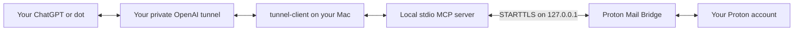

# Proton Mail Bridge Remote

Connect your own Proton mailbox to ChatGPT and dot through a Mac running Proton Mail Bridge and an OpenAI Secure MCP Tunnel. This unofficial, self-hosted integration defaults to read-only access. It is not a Proton or OpenAI product.

**Every user supplies their own Mac, Bridge account, tunnel, runtime key, and private ChatGPT connection.** This repository and its setup skill do not include a mailbox connection or credentials.

## Project and publication status

The source is available under the [MIT license](LICENSE). The public setup plugin is **not yet published**; there is no public installation link at this time. Its purpose is to guide setup and operation of your own private connection. Installing a setup skill does not grant mail access.

OpenAI currently supports Secure MCP Tunnel for private connections, not public plugin distribution. A public remote MCP plugin requires a stable public HTTPS endpoint. Therefore, your personal tunnel and mailbox connection must remain private. See the [official tunnel guide](https://developers.openai.com/api/docs/guides/secure-mcp-tunnels).

## How it works



The Mac initiates the tunnel connection over outbound HTTPS. You do not need router port forwarding. Bridge stays on the same Mac as the MCP process; its loopback IMAP/SMTP ports are not exposed to the internet. Proton documents that Bridge decrypts mail for local clients over loopback; this integration then returns requested content to your AI client. **Mail read by ChatGPT is processed by OpenAI, even though Bridge runs locally.** See [Proton's connection explanation](https://proton.me/support/bridge-ssl-connection-issue) and [Privacy](docs/PRIVACY.md).

## Requirements

- A Mac, such as an always-on Mac mini, running your normal logged-in macOS user. This project's Keychain and LaunchAgent integration is macOS-only.
- An existing Proton Mail plan that includes Bridge, and the [official Proton Mail Bridge app](https://proton.me/support/protonmail-bridge-install).
- Python 3.10 or newer, Git, and Homebrew if using the installation commands below.
- Access to your intended OpenAI Platform organization and ChatGPT workspace, including permission to create/use tunnels and add custom MCP servers.
- The Mac must remain awake, online, logged in, and able to unlock its Keychain. Leave Bridge signed in. A user LaunchAgent is not a service that runs before login after a reboot.

## Choose a setup route

**Route A — use our setup plugin when published.** Install the public setup plugin from its verified listing, then ask it to set up your own private Bridge tunnel. Publication is pending, so use Route B today. The public setup plugin will provide instructions; your private connector supplies mail tools after you finish setup.

**Route B — give ChatGPT or Codex this repository.** Use an agent with terminal access to the Mac and browser access to your OpenAI account. Copy the complete [Agent Prompt](docs/AGENT_PROMPT.md). A cloud-only chat cannot directly configure your Mac; it can guide the local steps. You can also follow the manual instructions below.

## Step-by-step setup

### 1. Keep the source in a permanent folder

Run these commands in Terminal on the Mac that will run Bridge. Choose another permanent folder if you prefer; moving it later requires reinstalling the LaunchAgent.

```bash
mkdir -p ~/Applications
git clone https://github.com/knowlet/Proton-Mail-Bridge-Remote-Plugin.git ~/Applications/Proton-Mail-Bridge-Remote-Plugin
cd ~/Applications/Proton-Mail-Bridge-Remote-Plugin
python3 --version
```

Run setup as your normal user, without `sudo`. Review downloaded source before executing it. No `curl | sh` installation is needed.

### 2. Prepare Proton Mail Bridge

1. Install and open the official Bridge app, then sign in to your Proton account in that app.
2. Open the account's **Mailbox details**. Note the Bridge username and IMAP/SMTP ports. The usual ports are `1143` and `1025`; use the values actually displayed.
3. In Bridge's advanced connection settings, choose **STARTTLS** for both IMAP and SMTP.
4. Export the **public TLS certificate** from Bridge's advanced settings to a local `.pem` file. Supply one certificate, not a private key or certificate bundle.
5. Keep the Bridge-generated mailbox password ready for the local terminal prompt. It is different from your Proton sign-in password.

Bridge's menu labels may vary by version. Use the [official Bridge installation instructions](https://proton.me/support/protonmail-bridge-install) if you need help locating account details.

### 3. Set up and check local mail access

```bash
python3 setup.py
python3 setup.py --check
```

Enter the Bridge username, actual ports, and exported certificate path when prompted. Enter the **Bridge password twice in the hidden local prompt**. Do not paste it into a chat, command, configuration file, screenshot, or issue.

The local credential helper accepts up to 512 characters and verifies the saved value exactly. If it rejects a longer credential, stop and report the length/format error without sharing the credential; do not truncate it.

Setup installs hash-verified dependencies into a separate user runtime, stores the password in macOS Keychain, and saves owner-only local settings. It verifies STARTTLS and IMAP login without reading messages. A successful check prints:

```text
IMAP login verified. No message was read, marked, drafted, or sent.
```

The initial mode is `read-only`. The trusted exported certificate is required; the code does not disable certificate verification.

### 4. Install the official tunnel client

```bash
brew tap openai/tools
brew install openai/tools/tunnel-client
tunnel-client --version
tunnel-client help quickstart
```

The deployment helper uses the official `init`, `doctor`, `run`, and `health` commands. If a later CLI release changes these commands, check its help and the [official tunnel-client repository](https://github.com/openai/tunnel-client) before changing the helper.

### 5. Create your private tunnel and runtime key

1. Open [OpenAI Platform → Tunnels](https://platform.openai.com/settings/organization/tunnels), selecting the intended organization.
2. Create a tunnel, or reuse a suitable one you own. Associate the intended ChatGPT workspace as well as the Platform organization.
3. Copy its complete **tunnel ID**. This identifier is not a password, but belongs in your local deployment settings, not this repository.
4. Create a restricted runtime API key with **Tunnels Read + Use**. Creating/editing tunnels requires **Read + Manage**. Do not use an administrator key for the runtime.
5. Keep the key available only for the hidden terminal prompt in the next step. If you lose its value, create a replacement rather than asking an agent to recover or print it.

Your organization/workspace administrator may need to grant access. The current [OpenAI tunnel guide](https://developers.openai.com/api/docs/guides/secure-mcp-tunnels) describes permissions and workspace associations.

### 6. Install the Mac background service

Replace `YOUR_TUNNEL_ID` below with the complete ID from Platform. Do not use a sample ID.

```bash
python3 deploy_mini.py install --tunnel-id YOUR_TUNNEL_ID
python3 deploy_mini.py status
```

Enter your runtime key twice in the hidden terminal prompts and complete any local Keychain authorization. The installer verifies the full saved value, creates a profile referring to an environment variable, checks that the generated profile does not contain the key, and validates it with the official client. The runtime key is loaded from Keychain when the service starts.

Before continuing, status should report `installed`, `service_loaded`, `process_running`, `healthy`, `ready`, and `control_plane_poll_seen` as `true`. If polling has just started, run status again after a few seconds. **`remote_mail_verified: false` is intentional:** local service health cannot prove a remote ChatGPT mail-tool call worked.

This helper manages one Proton service per macOS user. Other applications can run their own independent tunnels on the same Mac. A previous Proton process must fully stop before this helper starts its replacement; do not bypass a shutdown error by starting another runtime for the same tunnel.

### 7. Create your private ChatGPT mail connection

Do this in **ChatGPT on the web**, using the workspace associated with your tunnel:

1. Open [Plugins](https://chatgpt.com/plugins), select the plus button, then **Add custom MCP server**.
2. Give it a recognizable name, such as **My Proton Mail Bridge**.
3. Under **Connection**, choose **Tunnel**, then select or enter your own tunnel ID.
4. Choose **No authentication** for this single-user MCP server. OpenAI tunnel account/workspace permissions still control access; this project does not implement a separate OAuth account-selection service.
5. Review the displayed risk notice, then choose **Create as a plugin**.
6. Install/connect the resulting private plugin, review its tools, and keep its visibility private.
7. Start a new chat and select that connection using `@`.

If the tunnel is missing, revisit its workspace association and your tunnel permissions. See [OpenAI's custom MCP server instructions](https://developers.openai.com/api/docs/guides/custom-mcp-server).

### 8. Verify web, mobile, and dot separately

First ask the selected private connection:

> Only check Proton Mail Bridge connection status using `proton_connection_status` with `test_connection=true`. Do not read, draft, or send email.

Require an actual tool response with `connection: verified` and `mode: read-only`. Merely seeing a plugin, tool list, or ready tunnel is insufficient.

Then repeat that exact test in the **real ChatGPT mobile app** on your phone, signed into the same account and workspace. Select your private mail connection in a new chat. Finally ask **dot** to use the same private connection for the same status-only call. Record each result independently; a desktop browser in mobile layout does not test the phone app.

OpenAI documents plugin availability across supported interfaces and dot's use of supported installed plugins. Availability still depends on the account, workspace, permissions, and plugin. See [Plugins](https://learn.chatgpt.com/docs/plugins) and [Dot computers and apps](https://learn.chatgpt.com/docs/dots/computers-and-apps).

A private Mac deployment was checked during development: Bridge login and remote dot status succeeded; the user also reported a verified/read-only result in mobile ChatGPT. These observations do not certify another account or a public listing. Repeat the checks for your own deployment. Do not send test mail to verify connectivity.

## Available mail tools

| Mode | Tools and behavior |
| --- | --- |
| `read-only` (default) | Connection status, folders, recent headers, filtered search, and one message's plain text plus attachment metadata. Reading uses `BODY.PEEK` and does not mark messages read. |
| `drafts` | All read tools plus an explicitly requested server-side draft. |
| `send` | Read/draft tools plus sending with explicit user authorization for the recipients and message. |

HTML is not returned; HTML-only mail may have an empty text body. Attachment files are not downloaded. This facade does not expose deletion, moving messages, or changing flags. Search filters combine with AND, dates use `YYYY-MM-DD`, and `before` is exclusive. A recent-header list follows mailbox UID order, which can differ from date order after mail imports.

Only enable write modes when needed:

```bash
python3 setup.py --mode drafts
python3 deploy_mini.py install
```

Use `--mode read-only` to return to the default, or `--mode send` if you explicitly need sending. Reinstall/restart the service and refresh the private connection's tools after a mode change. Enabling a mode does not authorize any particular draft or message. Never automatically retry a send after an unknown or partial outcome.

## Daily operation and credential changes

Run these from your permanent source folder:

```bash
# Check local Bridge login without reading mail.
python3 setup.py --check

# Check service health and active control-plane polling.
python3 deploy_mini.py status

# Replace the saved tunnel runtime key through a hidden prompt.
python3 deploy_mini.py install --replace-key

# Re-enter Bridge details/password; then reload the mail process.
python3 setup.py --replace-password
python3 deploy_mini.py install

# Stop and disable this project's background service.
python3 deploy_mini.py stop
```

`stop` retains settings and Keychain entries. Run `install` again to re-enable the service. To revoke remote access immediately, also disconnect your private ChatGPT connection and revoke the runtime key/tunnel in Platform. Uninstalling a setup skill alone does not stop a previously installed Mac service.

Local files live under `~/.config/proton-mail-bridge-plugin/`; the LaunchAgent is `~/Library/LaunchAgents/local.proton-mail-bridge.tunnel.plist`. Passwords are stored in Keychain, not these files. The runtime API key exists in process memory/environment while the official tunnel client is running. Local administrators or processes with access to your user session are part of your trust boundary.

## Troubleshooting

| Symptom | Check or next action |
| --- | --- |
| `setup.py --check` fails | Bridge is running and signed in; use its generated mailbox password, actual ports, STARTTLS, and current exported public certificate. Unlock your login Keychain. |
| Bridge certificate changed | Export the new certificate and rerun `setup.py`; verify the replacement before typing the requested confirmation. Do not disable TLS checks. |
| Tunnel is unauthorized / HTTP 401 | Verify the full runtime key, intended organization, and Tunnels Read + Use. Run `install --replace-key` locally. Do not paste keys or raw authentication logs into chat. |
| Credential format or repeat-entry error | Paste the complete value twice into the hidden local prompts. The helper supports at most 512 characters; do not shorten a key or bypass read-back verification. |
| Generated profile unexpectedly contains a credential | Installation was stopped deliberately. Update/review the helper and official client; never remove the check or publish the generated profile. |
| Prior launchd service did not stop | Do not start a second runtime. Check the existing Proton service and prior process; let shutdown finish before reinstalling. Preserve other applications' services. |
| Running process, but not ready/polling | Check outbound HTTPS connectivity, key access, CLI compatibility, and the intended tunnel. A running process alone is not a successful connection. |
| Tunnel missing in ChatGPT | Check Platform organization, ChatGPT workspace association, permissions, and workspace restrictions. |
| Skill installed, but no mail tools | Create/install the private custom MCP connection in step 7. The public setup skill does not contain a shared mail account. |
| Web works, phone/dot does not | Confirm the same account/workspace, plugin installation, tool permissions, and current app. Perform and record a separate status call in each interface. |
| Stops after reboot or sleep | Log into macOS, unlock Keychain, start/sign into Bridge, and keep the Mac awake and online. |

Share only redacted diagnostics. Logs, handoff files, usernames, certificates, mail text, and tunnel metadata can contain personal information even when they contain no password.

## Development and public distribution

The generic plugin package contains a setup/operation skill and source code, with no preconfigured App reference, tunnel ID, mailbox username, runtime key, or live MCP URL. The separately created private ChatGPT connection is user-specific.

For a local test environment:

```bash
python3 -m venv .venv
.venv/bin/python -m pip install --require-hashes -r server/requirements.txt
.venv/bin/python -m unittest discover -s server -p 'test_*.py'
```

Offline tests do not prove real Keychain access, a live Bridge login, or phone/dot availability. Use the end-to-end status checks above for those.

Publishing a generic setup skill and publishing a remote mail service are different architectures. Do not convert your private fixed-account mailbox connector into a public service. A future shared remote service would require its own publicly reachable endpoint, per-user authentication/isolation, review, and accurate data policies. OpenAI's [submission guide](https://developers.openai.com/plugins/deploy/submission) explains the public review and publishing process.

## Documentation, support, and license

- [Full Agent Prompt](docs/AGENT_PROMPT.md)
- [Privacy and data flow](docs/PRIVACY.md)
- [Terms and license context](docs/TERMS.md)
- [Security and reporting](docs/SECURITY.md)
- [Third-party source attribution](THIRD_PARTY.md)
- [Report a redacted issue](https://github.com/knowlet/Proton-Mail-Bridge-Remote-Plugin/issues)

MIT © 2026 Albert Hsieh. Third-party notices and licenses are retained separately. Proton and OpenAI names identify the services used; this project does not claim their endorsement.
